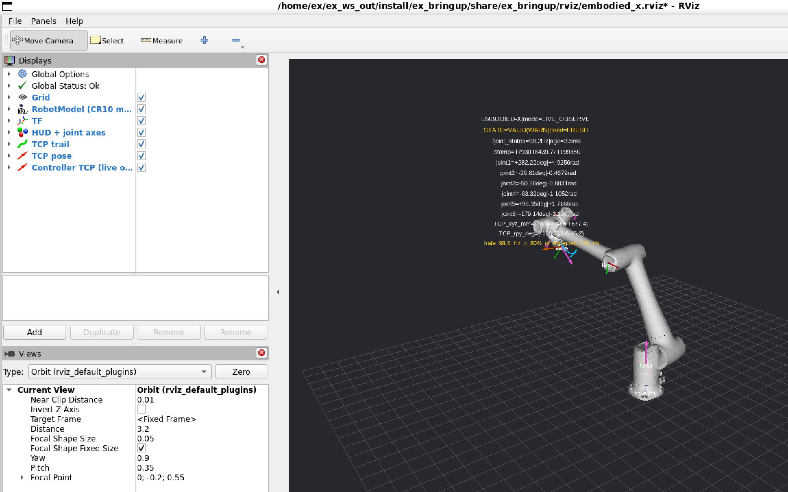
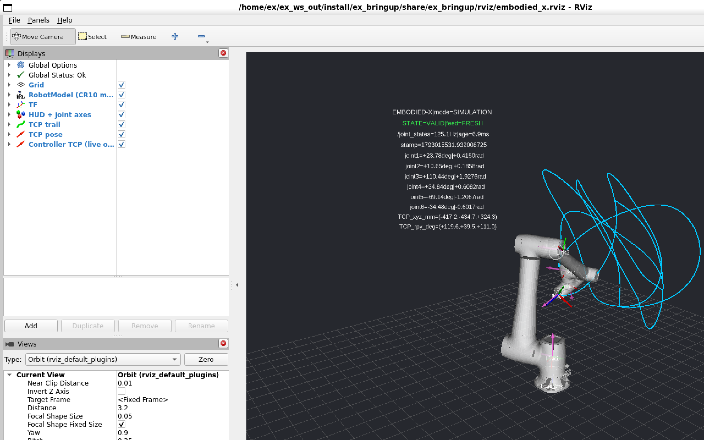
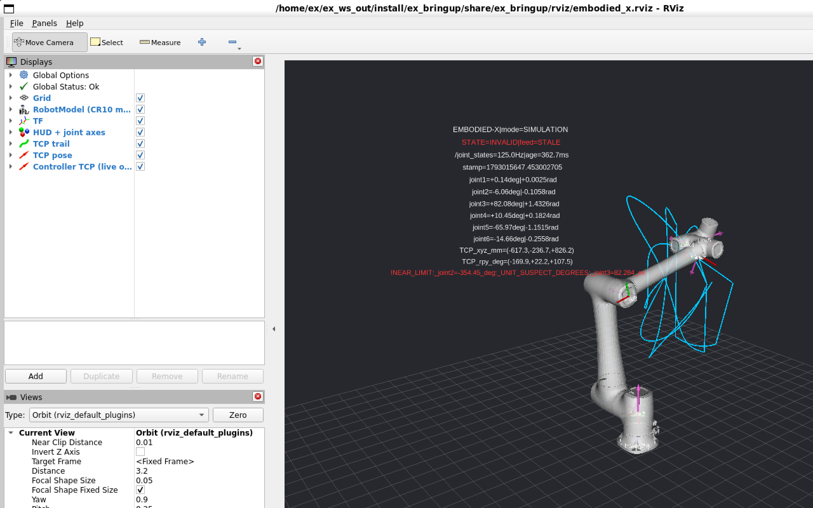

# EMBODIED-X — From Simulation to Physical Intelligence

A research-engineering lab around a **Dobot CR10A** 6-axis cobot: perception → state estimation →
planning → control → verification → learning. Built in stages; each stage ships working code,
tests, measured results and an honest failure analysis.

**Current milestone (M1): read-only digital twin.** The real CR10A's joint feedback drives an RViz
model, *one way only* (Physical Robot → ROS 2 → RViz). Everything runs and is tested **without
hardware**; the live path has been exercised only against a local mock controller so far.


*REAL robot, LIVE_OBSERVE (read-only, port 30004): the operator hand-guides the CR10A in drag mode and the RViz
model follows. The yellow WARN is the 94 Hz publish-rate bug found on site (fixed afterwards: 123 Hz).*


*SIMULATION mode (simulated data): CR10 model, TF frames, joint axes (magenta), TCP trail, HUD with
joint angles / rate / freshness / TCP pose.*


*Fault injection (`fault:=degrees`): the adapter rejects the samples, the display freezes on the last
valid state and the HUD turns red with the reason.*

## Status

| Item | State |
|---|---|
| SIMULATION / REPLAY (rosbag2) / fault injection | ✅ verified (integration run06) |
| LIVE_OBSERVE against **mock** controller (sends 0 bytes) | ✅ verified |
| LIVE_OBSERVE against the **real CR10A** | ✅ 2026-10-26 on site, read-only ([results](docs/HARDWARE_COMPATIBILITY.md#7-现场只读连接结果2026-10-26)) |
| CR10A kinematic model | ✅ official `cr10` geometry: FK vs controller 1.6–3.0 mm RMS, 5.5 mm max over 41k real samples |
| M2 MoveIt planning lab (sim) | ✅ 400-plan OMPL benchmark ([report](docs/M2_PLANNING_LAB.md)) |

## Quick start (Windows 11 + WSL2)

```powershell
# 1. dedicated distro (does not touch your other WSL distros)
wsl --install Ubuntu-22.04 --name EmbodiedX-Humble --location C:\WSL\EmbodiedX-Humble --no-launch --web-download
wsl -d EmbodiedX-Humble -u root -- bash /mnt/c/Users/<you>/embodied-x/scripts/setup_wsl_humble.sh
```
```bash
# 2. inside EmbodiedX-Humble
cd /mnt/c/Users/<you>/embodied-x
bash scripts/fetch_third_party.sh          # pinned Dobot sources (only needed for tests/analysis)
bash scripts/build.sh                      # colcon -> ~/ex_ws_out
bash scripts/test.sh                       # 67 unit tests (ROS-free core + safety)
bash scripts/integration_test.sh           # 4 stages, headless, ~3 min

# 3. demos (RViz opens via WSLg)
bash scripts/run_demo.sh simulation                    # optional: fault:=dropout|jump|degrees|nan|wrong_names
bash scripts/record_bag.sh my_run 30                   # record while a demo runs
bash scripts/run_demo.sh replay bag:=$PWD/data/bags/my_run loop:=true
```
Stop with `Ctrl-C`. Live robot: **only** via [docs/LIVE_ROBOT_CHECKLIST.md](docs/LIVE_ROBOT_CHECKLIST.md).

## Repository map

```
ros2_ws/src/ex_description   CR10 URDF (vendored from official Dobot repo, MIT) + world/flange/tcp frames
ros2_ws/src/ex_robot_state   core/ (ROS-free) · nodes/ (adapter, monitor, observer, checks) · tools/ (mock controller)
ros2_ws/src/ex_bringup       embodied_x.launch.py · modes/*.yaml · RViz config
evaluation/                  crosscheck_bag.py — offline model identification from one live recording
scripts/                     setup, build, test, integration, record, vendor, compare models, capture
docs/                        ARCHITECTURE · HARDWARE_COMPATIBILITY · SAFETY · LIVE_ROBOT_CHECKLIST · ROADMAP · PROGRESS
third_party/MANIFEST.yaml    pinned upstream commits (sources are fetched, not committed)
```

## Troubleshooting

| Symptom | Cause / fix |
|---|---|
| `apt` in WSL can't reach mirrors, Windows can | Proxy in TUN/fake-ip mode not reachable from WSL NAT. Use the offline path in PROGRESS.md (download .deb on Windows, `apt-get install --no-download`). |
| RViz robot not moving, `/joint_states` silent | QoS mismatch or adapter rejecting: `ros2 topic echo /diagnostics`, HUD shows the reason. |
| HUD text with huge gaps | RViz/OGRE font in WSLg renders spaces wide; HUD uses no spaces by design. |
| `CONFLICT: other publishers on /joint_states` | A `joint_state_publisher(_gui)` or a bag replaying `/joint_states` is running; stop it. |
| bash `$'\r': command not found` | CRLF line endings; repo enforces LF via `.gitattributes`. |

## License & attribution
Project code: MIT (see headers). `ex_description/meshes/cr10_official` and the derived CR10 macro come
from [Dobot-Arm/DOBOT_6Axis_ROS2_V4](https://github.com/Dobot-Arm/DOBOT_6Axis_ROS2_V4) (MIT, © Dobot).
Use of the physical robot and publication of recordings follow the owning organization's rules.
