# EMBODIED-X: From Simulation to Physical Intelligence

A research-engineering lab around a real **Dobot CR10A** 6-axis cobot. Pipeline:
read-only digital twin → kinematic calibration → MoveIt planning → MuJoCo physics → dynamics identification on the real arm → learning.
Every stage ships working code, tests, measured results and an honest failure analysis. Simulated and real data are always labelled.

> 🇨🇳 想自己上手看画面：[hands_on/README.md](hands_on/README.md)，双击 `.bat` 就能打开 MuJoCo 和 RViz。

## At a glance
| Stage | Headline result | Details |
|---|---|---|
| **M1** Read-only digital twin (**real CR10A**) | Live joint sync over port 30004 (sends 0 bytes); the official `cr10` model matches the controller to 1.6–5.5 mm | [HARDWARE_COMPATIBILITY](docs/HARDWARE_COMPATIBILITY.md) |
| **M1.5** Kinematic calibration (**real data**) | Controller model recovered: held-out error **0.002–0.011 mm**, 0.207° flange tilt found | [CALIBRATION](docs/CALIBRATION.md) |
| **M2** MoveIt planning lab (sim) | 400-plan OMPL benchmark: RRTConnect/SBL 39/40, narrow passages separate the planners | [M2_PLANNING_LAB](docs/M2_PLANNING_LAB.md) |
| **M4** MuJoCo physics plant (sim) | Behind ros2_control, MoveIt unchanged; tracking error ∝ 1/servo bandwidth (3–15 mm) | [M4_MUJOCO](docs/M4_MUJOCO.md) |
| **M4.5** Dynamics identification (**real CR10A moving**) | URDF masses are 1.64× too light (≈ 40 kg datasheet); Coulomb friction 10–14 N m; sim-to-real torque gap cut **3–6×** | [DYNAMICS_ID](docs/DYNAMICS_ID.md) |
| **M5** Learning (sim) | Wall task: straight line 96 % collisions, potential field 44 % success, **PPO 58 % / 0 % collisions** (1 seed so far) | [LEARNING](docs/LEARNING.md) |

---

## M1: read-only digital twin of the real CR10A

*REAL robot, LIVE_OBSERVE (read-only, port 30004): the operator hand-guides the CR10A in drag mode and the RViz model follows. The yellow WARN is the 94 Hz publish-rate bug found on site (fixed afterwards: 123 Hz).*

| Simulation mode | Fault injection |
|---|---|
|  |  |
| *Simulated data: CR10 model, TF frames, joint axes, TCP trail, HUD with joint angles, rate, freshness and TCP pose.* | *`fault:=degrees`: the adapter rejects the samples, the display freezes on the last valid state and the HUD turns red with the reason.* |

## M1.5: kinematic calibration from on-site data
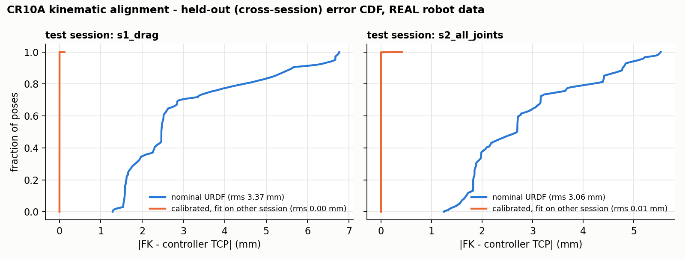
*REAL data, cross-session (fit on one session, test on the other). Nominal official model 3.1–3.4 mm RMS → 45-parameter regularised model (rank 25) **0.002 / 0.011 mm**. This recovers the controller's own calibrated model; it is not a metrology result.*

## M2: MoveIt planning lab (simulation)
| Success rate | Planning time |
|---|---|
| 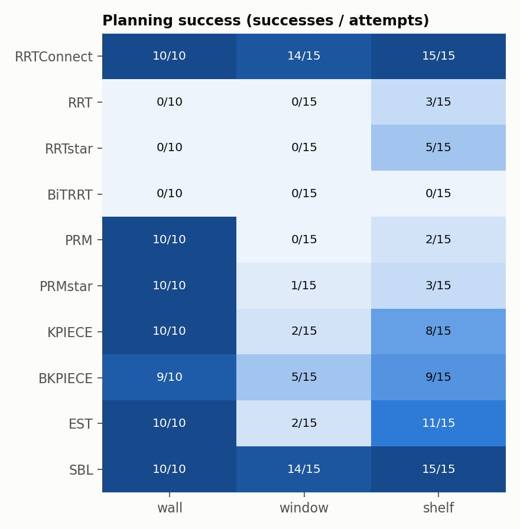 | 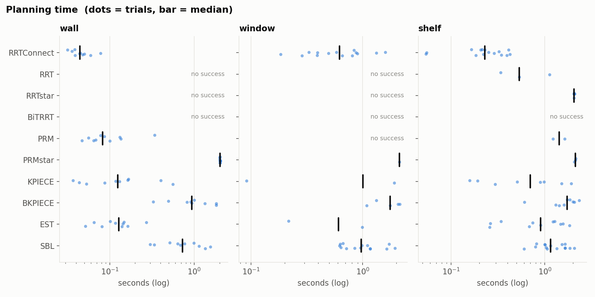 |
| **Clearance** | **Path length** |
| 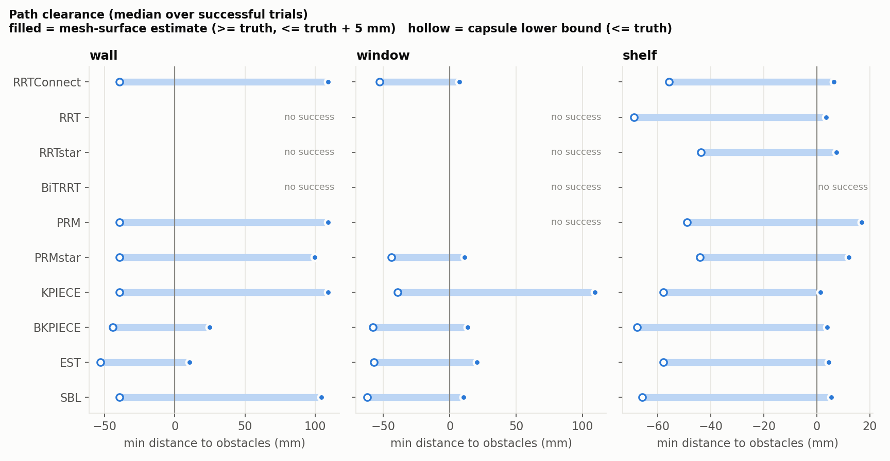 | 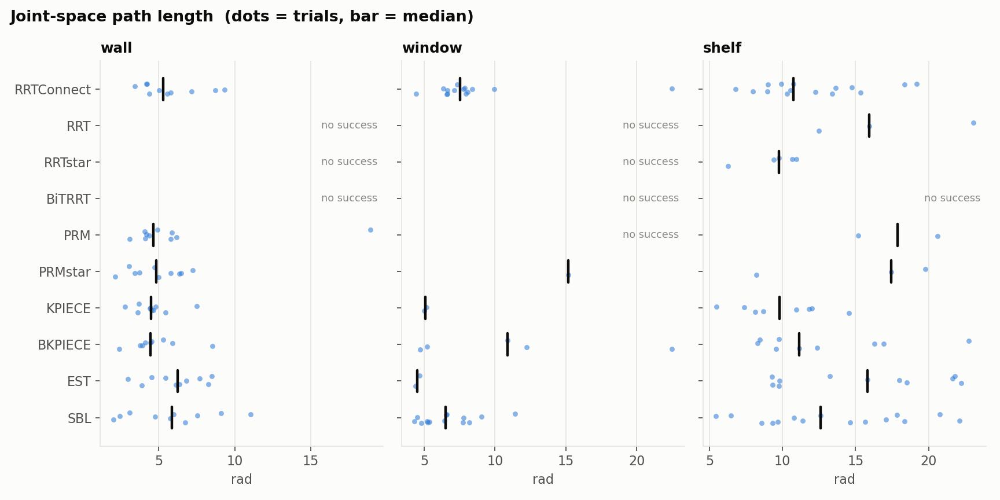 |

| Wall | Window (narrow passage) | Shelf |
|---|---|---|
| 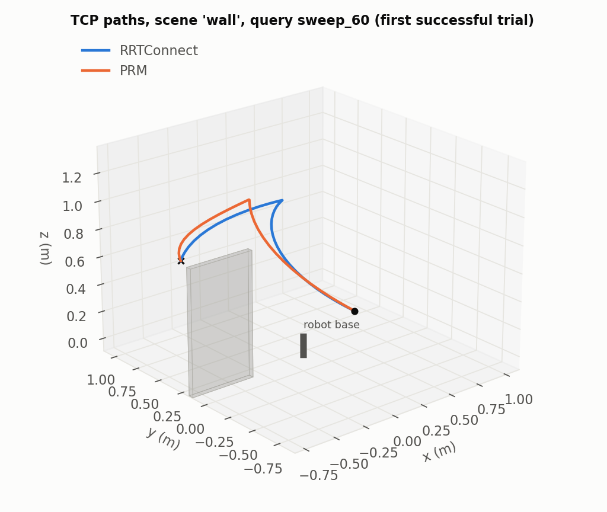 | 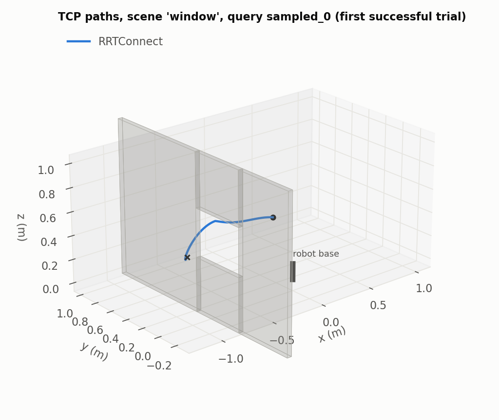 | 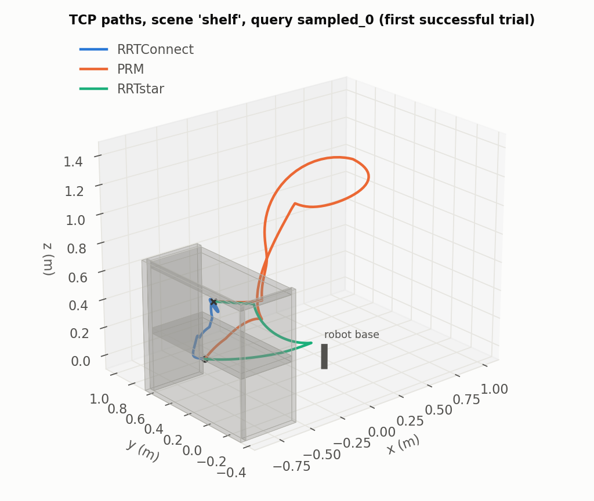 |

*400 plans (3 scenes × 8 queries × 10 OMPL planners × 5). Bidirectional trees win (RRTConnect, SBL 39/40). In the window scene, PRM gets 0/15. Asymptotically optimal planners always use the full budget for small path gains. BiTRRT 0/40 is not explained yet.*

## M4: MuJoCo physics plant behind ros2_control (simulation)
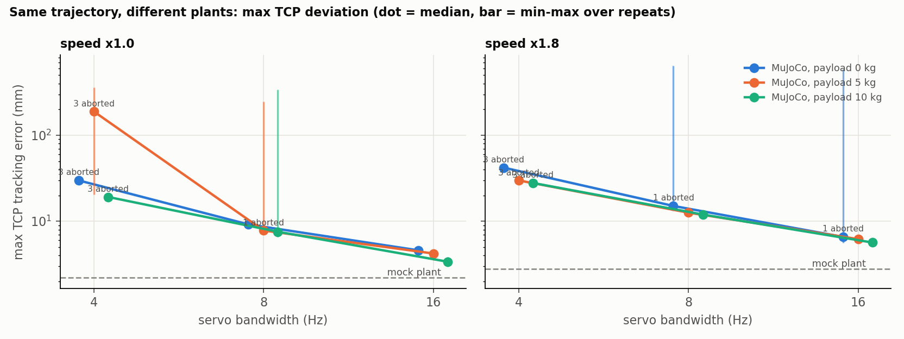
*60 executions of one trajectory: mock plant 2.2 mm; servo 16 Hz 3.4–6.6 mm; 8 Hz 7.6–15 mm; 4 Hz cannot track (0/18).*

Other findings:
- A wrong `SetPayload` makes the PD servo sag (10 kg true / 0 kg configured gives 42 mm).
- With the dynamics identified on the real arm, tracking error at 8 Hz is **+50 %**, so the earlier predictions were optimistic.

## M4.5: dynamics identification on the real, moving CR10A
The arm moved under program control: owner on site at the e-stop, unit authorization, motion module `ex_dobot_motion` with whitelist, caps, validated plans and dry-run by default.

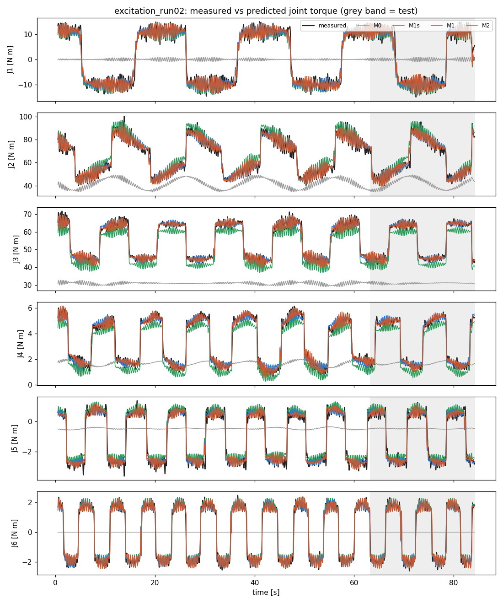
*REAL data, 85 s excitation, 0.4 kg camera on the flange. Black = measured joint torque. The URDF alone (grey) explains almost nothing: friction dominates and the masses are too light. Fitted models reach a held-out VAF of 96–99 %. The method was first validated on MuJoCo data with known truth: armature, Coulomb friction and mass scale are recovered; viscous friction is not identifiable at these speeds, and the docs say so.*

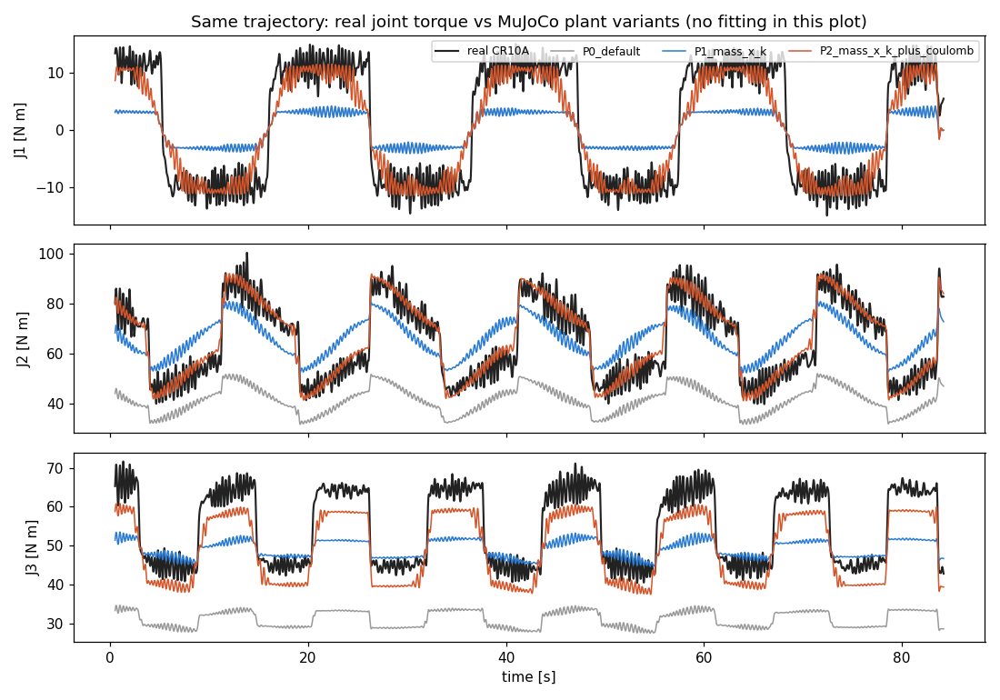
*Same real trajectory replayed in MuJoCo: default plant vs the identified preset (`dynamics:=identified_run02`). The J2/J3 torque gap drops from 24–25 N m to 4–6 N m.*

## M5: learning (simulation)
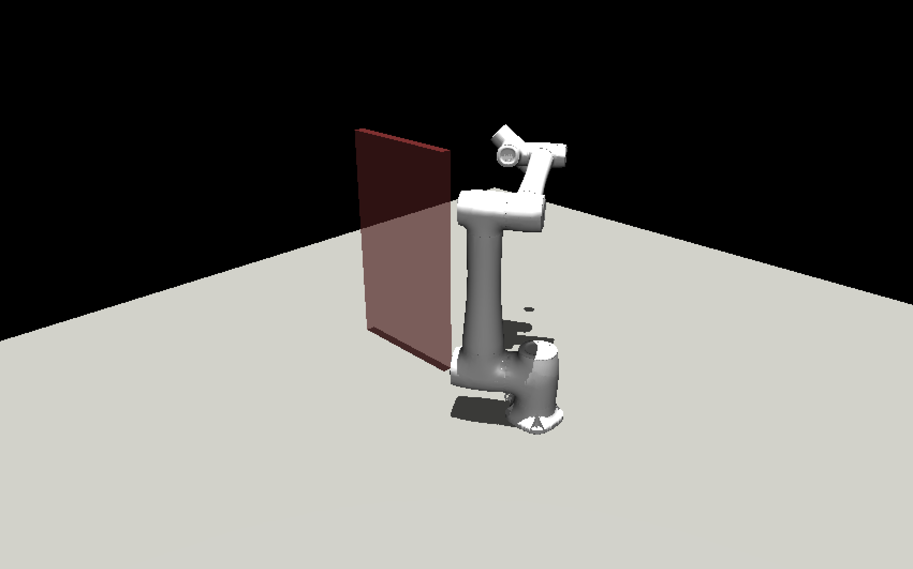
*Reach-around-the-wall task in the MuJoCo viewer. Classical baselines first: DLS 4 % success / 96 % collisions, potential field 44 % / 0 %, PPO (seed 0) 58 % / 0 %. More seeds are running.*

Failures found and fixed on the way (all documented with regression tests):
- PPO learned to **crash on purpose** under a −distance reward.
- MuJoCo mesh distance queries returned swapped endpoints and spurious zeros.
- The passive viewer segfaults when it closes under WSLg.

## Hands-on: the full pipeline
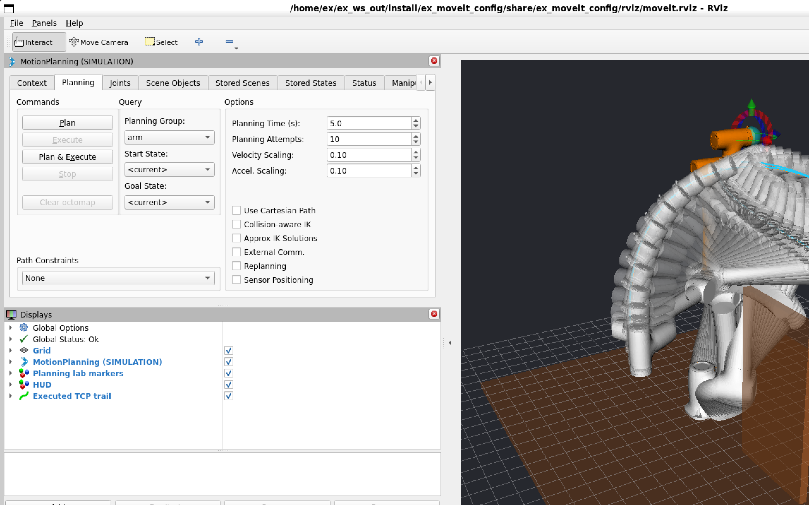
*`hands_on/4_moveit_rviz_mujoco.bat`: MoveIt plans around the wall (RViz: planned trajectory trail, goal in orange, executed TCP path in cyan) and the MuJoCo plant executes it with physics in its own window (below, wall not modelled in physics).*

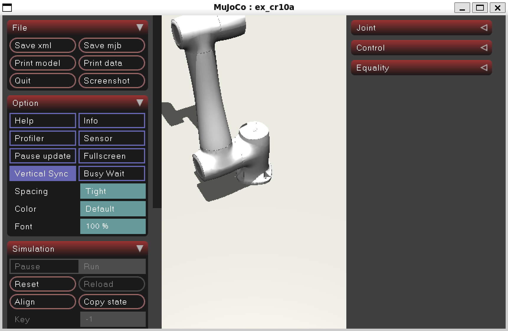

---

## Quick start (Windows 11 + WSL2)
```powershell
# 1. dedicated distro (does not touch your other WSL distros)
wsl --install Ubuntu-22.04 --name EmbodiedX-Humble --location C:\WSL\EmbodiedX-Humble --no-launch --web-download
wsl -d EmbodiedX-Humble -u root -- bash /mnt/c/Users/<you>/embodied-x/scripts/setup_wsl_humble.sh
```
```bash
# 2. inside EmbodiedX-Humble
cd /mnt/c/Users/<you>/embodied-x
bash scripts/fetch_third_party.sh          # pinned Dobot sources (only needed for tests/analysis)
bash scripts/build.sh                      # colcon -> ~/ex_ws_out
bash scripts/test.sh                       # unit tests (ROS-free core, safety, dynamics, learning envs)
bash scripts/integration_test.sh           # 4 stages, headless, ~3 min

# 3. demos (windows open via WSLg)
bash scripts/run_demo.sh simulation                                   # M1 digital twin in RViz
bash scripts/m2_session.sh start true plant:=mujoco mujoco_viewer:=true   # M2/M4: MoveIt + RViz + MuJoCo
cd learning && python3 -m ex_learning.view_policy --task wall --policy apf # M5 viewer
```
Or double-click the launchers in [`hands_on/`](hands_on/README.md). Live robot: **only** via [docs/LIVE_ROBOT_CHECKLIST.md](docs/LIVE_ROBOT_CHECKLIST.md).

## Repository map
```
ros2_ws/src/ex_description    CR10 URDF (official Dobot, MIT) + calibrated joint frames + world/flange/tcp
ros2_ws/src/ex_robot_state    core/ (ROS-free: feedback decoding, FK, calibration, dynamics regressor) · nodes · mock controller
ros2_ws/src/ex_bringup        M1 launch, modes, RViz config
ros2_ws/src/ex_moveit_config  MoveIt 2 + ros2_control (plant: mock | mujoco)
ros2_ws/src/ex_planning_lab   M2 scenes, benchmark, execute demo, capsule clearance metric
ros2_ws/src/ex_mujoco_sim     M4 MuJoCo plant: URDF->MJCF, servo model, dynamics presets
ros2_ws/src/ex_dobot_motion   the ONLY motion-capable package: whitelist, caps, validated plans, dry-run default
learning/                     M5 envs (reach, wall), baselines (DLS, APF), PPO, viewer
evaluation/                   calibration, dynamics identification, sim2real, plots
hands_on/                     double-click demos + guide (Chinese)
docs/                         one document per stage + SAFETY, LIVE_ROBOT_CHECKLIST, ROADMAP, PROGRESS, evidence/
```

## Troubleshooting
| Symptom | Cause / fix |
|---|---|
| `apt` in WSL can't reach mirrors, Windows can | Proxy in TUN/fake-ip mode not reachable from WSL NAT. Use the offline path in PROGRESS.md (download on Windows, install offline). |
| RViz robot not moving, `/joint_states` silent | QoS mismatch or adapter rejecting: `ros2 topic echo /diagnostics`, HUD shows the reason. |
| HUD text with huge gaps | RViz/OGRE font in WSLg renders spaces wide; HUD uses no spaces by design. |
| `CONFLICT: other publishers on /joint_states` | A `joint_state_publisher(_gui)` or a bag replaying `/joint_states` is running; stop it. |
| MoveIt answers inconsistently | More than one `move_group` alive: always use `scripts/m2_session.sh` (guarantees one). |
| bash `$'\r': command not found` | CRLF line endings; repo enforces LF via `.gitattributes` (CRLF only for `.bat`/`.ps1`). |

## License & attribution
Project code: MIT (see headers). `ex_description/meshes/cr10_official` and the derived CR10 macro come from [Dobot-Arm/DOBOT_6Axis_ROS2_V4](https://github.com/Dobot-Arm/DOBOT_6Axis_ROS2_V4) (MIT, © Dobot).
Use of the physical robot and publication of recordings follow the owning organization's rules.
