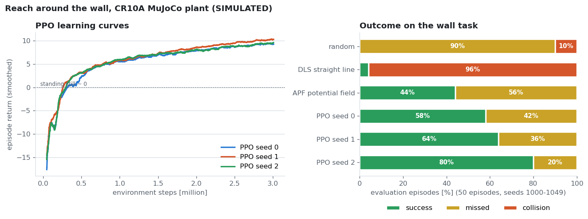

# Learning (M5): reach and reach-around-the-wall on the CR10A MuJoCo plant (SIMULATION ONLY)

Code: `learning/ex_learning/` (envs, baselines, PPO, viewer). Tests: `learning/tests/` (10, part of `scripts/test.sh`).
Rule followed: **classical baseline first**, then RL. The same evaluation protocol is used for every policy: 50 episodes, seeds 1000–1049, deterministic policy.

## Environments
- **Reach** (`cr10a_reach.py`): the M4 plant (same MJCF builder and servo model, 1 kHz physics, 50 Hz policy).
  - Action: joint-velocity command in [-1, 1]^6 (× 1 rad/s), integrated into the servo set-point.
  - Observation: 21-dim (q, qd, tcp, goal, goal − tcp).
  - Success: TCP within 2 cm of the goal.
- **Wall** (`cr10a_reach_wall.py`): the M2 `wall` scene. Start and goal sit on opposite sides of the wall, around query `sweep_60`, with ±8° noise and sides swapped at random. Episode length 300 steps (6 s).
  - Collision is **detected, not simulated**: the signed distance between the M2 enclosing link capsules and the scene boxes.
  - The capsules contain the meshes, so the clearance is conservative.

## Results (50 evaluation episodes)
| Task | Policy | Success | Collisions | Final distance (median) |
|---|---|---|---|---|
| reach | random | 0 % | – | 511 mm |
| reach | DLS Jacobian | **100 %** | – | ≈ 0 mm |
| wall | random | 0 % | 10 % | 1432 mm |
| wall | DLS Jacobian (straight line) | 4 % | **96 %** | 781 mm |
| wall | APF (DLS + repulsion of every link capsule; k_rep, d0 tuned on seeds 0–19) | 44 % | 0 % | 34 mm |
| wall | **PPO seed 0** (3 M steps, 12 envs, CPU, 38 min) | 58 % | 0 % | 18 mm |
| wall | **PPO seed 1** (32 min) | 64 % | 0 % | 16 mm |
| wall | **PPO seed 2** (22 min) | 80 % | 0 % | 12 mm |
| wall | **PPO, 3 seeds** | **67 % mean (58–80)** | **0 %** | **12–18 mm** |

**All three seeds beat the best classical baseline** (APF 44 %, 22/50) on the same 50 evaluation episodes (worst seed 29/50), and none of them collides.
- The learning curves are nearly identical across seeds, but the success rate spreads from 58 % to 80 %. Most misses end 20–40 mm from the goal, right at the 2 cm success threshold, so the success rate is sensitive to that threshold.
- The return is still rising at 3 M steps: training is not converged.
- Training time differs between seeds (22–38 min) because of CPU load on the laptop, not because of the algorithm.

Observations:
- Free-space reaching is solved by a 5-line classical controller, so it is not a reason to use RL.
- On the wall task, the straight-line controller collides almost every time, and the potential field avoids the wall but gets stuck in local minima.
- PPO (seed 0) never collides and gets closer more often.
- Most PPO "failures" stop 20–40 mm from the goal, just outside the 2 cm success radius (see `view_policy`).

## Failure analysis (found while building, all fixed with regression tests)
| # | Symptom | Cause | Fix |
|---|---|---|---|
| 1 | APF collided in 100 % of episodes, for any gain | `mj_geomDistance`'s `fromto` endpoints come back **swapped** for mesh-vs-box pairs (the collider orders geoms by type), so the repulsion pushed the arm *into* the wall. Found with a repulsion-only test. | Distances via capsules; test `test_repulsion_alone_increases_wall_clearance` |
| 2 | Clearance occasionally exactly `0.0` between two readings of ~0.19 m | Mesh–box GJK returned spurious zeros in 3.3 % of 9,600 queries. Changing `ccd_iterations` crashed MuJoCo 3.3.7 (segfault). | Numpy capsule-vs-AABB distance; test `test_clearance_is_continuous_along_a_path` |
| 3 | APF still only pushed one link while another hit the wall | Repulsion only from the single nearest pair | Repulsion from every capsule within d0 |
| 4 | Start poses "in collision" | The Link2 capsule (r 0.15 m, J2 motor housing) overlaps the table by 3.8 cm in **every** pose | Ignore Link2–table (as M2 ignores base/Link1–table); arm-to-table contact is still covered by Link3–Link6 |
| 5 | **PPO learned to crash**: episode length fell from 139 to 22 steps while the return "improved" from −202 to −44 | Reward v1 = −distance per step: ending the episode early by colliding (−10 once) beat living on (≈ −0.5 per remaining step) | Potential-based progress reward (standing still ≈ 0); test `test_crashing_early_never_pays`; the bad run is kept as `ppo_wall_s0_v1_suicide_reward` |
| 6 | Viewer process exits with 139 (segfault) | The MuJoCo passive viewer crashes when it is closed under WSLg, both via `close()` and via the context manager | `os._exit(0)` after flushing output (verified: exit 0) |

## Environment notes
- RL dependencies (torch 2.5.1 CPU, gymnasium 1.0, SB3 2.4.1) live in an isolated venv `~/ex_rlenv` (`--system-site-packages`), installed offline from wheels downloaded on Windows. The system numpy 1.21.5 that ROS needs is untouched.
- Throughput: about 550–1100 env steps/s with 12 subprocess envs on the laptop.

## Not done / next
- Longer training (curves still rising) and a success-vs-threshold curve, instead of one 2 cm cut.
- A harder scene (window, narrow passage) where APF should collapse.
- Domain randomization over the identified dynamics (`identified_run02` vs `placeholder`) and a sim-to-sim transfer check.
- Nothing here has been run on hardware. A learned policy on the real arm would need its own safety case.
