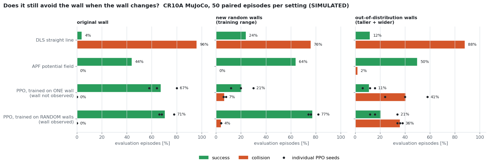

# Learning (M5): reach and reach-around-the-wall on the CR10A MuJoCo plant (SIMULATION ONLY)

Code: `learning/ex_learning/` (envs, baselines, PPO, viewer). Tests: `learning/tests/` (10, part of `scripts/test.sh`).
Rule followed: **classical baseline first**, then RL. The same evaluation protocol is used for every policy: 50 episodes, seeds 1000–1049, deterministic policy.

## Environments
- **Reach** (`cr10a_reach.py`): the M4 plant (same MJCF builder and servo model, 1 kHz physics, 50 Hz policy).
  - Action: joint-velocity command in [-1, 1]^6 (× 1 rad/s), integrated into the servo set-point.
  - Observation: 21-dim (q, qd, tcp, goal, goal − tcp).
  - Success: TCP within 2 cm of the goal.
- **Wall** (`cr10a_reach_wall.py`): the M2 `wall` scene. Start and goal sit on opposite sides of the wall, around query `sweep_60`, with ±8° noise and sides swapped at random. Episode length 300 steps (6 s).
  - Collision is **detected, not simulated**: the signed distance between the M2 enclosing link capsules and the scene boxes.
  - The capsules contain the meshes, so the clearance is conservative.

## Results (50 evaluation episodes)
| Task | Policy | Success | Collisions | Final distance (median) |
|---|---|---|---|---|
| reach | random | 0 % | – | 511 mm |
| reach | DLS Jacobian | **100 %** | – | ≈ 0 mm |
| wall | random | 0 % | 10 % | 1432 mm |
| wall | DLS Jacobian (straight line) | 4 % | **96 %** | 781 mm |
| wall | APF (DLS + repulsion of every link capsule; k_rep, d0 tuned on seeds 0–19) | 44 % | 0 % | 34 mm |
| wall | **PPO seed 0** (3 M steps, 12 envs, CPU, 38 min) | 58 % | 0 % | 18 mm |
| wall | **PPO seed 1** (32 min) | 64 % | 0 % | 16 mm |
| wall | **PPO seed 2** (22 min) | 80 % | 0 % | 12 mm |
| wall | **PPO, 3 seeds** | **67 % mean (58–80)** | **0 %** | **12–18 mm** |

**All three seeds beat the best classical baseline** (APF 44 %, 22/50) on the same 50 evaluation episodes (worst seed 29/50), and none of them collides.
- The learning curves are nearly identical across seeds, but the success rate spreads from 58 % to 80 %. Most misses end 20–40 mm from the goal, right at the 2 cm success threshold, so the success rate is sensitive to that threshold.
- The return is still rising at 3 M steps: training is not converged.
- Training time differs between seeds (22–38 min) because of CPU load on the laptop, not because of the algorithm.

Observations:
- Free-space reaching is solved by a 5-line classical controller, so it is not a reason to use RL.
- On the wall task, the straight-line controller collides almost every time, and the potential field avoids the wall but gets stuck in local minima.
- PPO (seed 0) never collides and gets closer more often.
- Most PPO "failures" stop 20–40 mm from the goal, just outside the 2 cm success radius (see `view_policy`).

## Harder: the window scene (narrow passage)
M2 `window` scene: a wall at x = −0.90 m with a 0.50 × 0.40 m window; start TCP on the robot side, goal TCP **behind** the wall (x −1.25…−1.00 m), so the forearm has to thread the window.
- Start and goal come from fixed pools of 256 collision-free configurations each, built by two-phase rejection sampling: uniform, then within the joint sub-box of the first 50 hits ±10°.
- Collision uses **mesh point clouds** (5 mm surface samples, 1 cm voxels, conservative margin 1.73 cm) with a bounding-sphere broad phase, which matches brute force exactly.
- The one-capsule-per-link model cannot thread the window: only 1 of 98 goal configurations in the box was collision-free.

| Method (50 eval episodes) | Success | Collisions | Note |
|---|---|---|---|
| DLS straight line | 6 % | 76 % | |
| APF (9 gain settings tried on tuning seeds: **all 0 %**) | 0 % | 0 % | stuck in front of the wall, median 452 mm |
| Joint-space straight line, **privileged** (knows the goal configuration) | 0 % | 100 % | no episode has a naive solution |
| PPO seed 0, 5 M steps | 0 % | 0 % | gets closer than APF (median 216 mm), never through |
| **RRT-Connect** (joint space, same collision model, 5 mm margin, ≤ 60k checks) + path following | **38 %** | 2 % | 40 % planned (median 21 s); 19/20 plans executed, 1 grazed (−2 mm); needs 30 s execution |

Reading:
- Narrow passages are where sampling-based planning wins and reactive methods (APF, the PPO policy) fail.
- The window episodes are solvable (40 % within the check budget), just rare and long.
- This matches M2, where MoveIt's RRTConnect solved 14/15 window queries with exact mesh collision checking and µs-level checks.

## Generalisation: does it still avoid the wall when the wall moves?
The wall-task PPO above is trained and tested on **one** wall. Question: is it an obstacle-avoidance skill or a memorised trajectory?
- `wall_rand` / `wall_rand_blind`: a new wall every episode, centre x −0.80…−0.60, y ±0.10 m, height 0.70–1.00 m, width 0.35–0.60 m (the training ranges). `_blind` = the wall is not in the observation (for models trained on the fixed wall).
- `wall_ood` / `wall_ood_blind`: out-of-distribution walls, taller (1.00–1.15 m) and wider (0.60–0.75 m), x −0.85…−0.55, y ±0.15 m.
- "Generalist" PPO: trained on `wall_rand` with the wall box (centre, half-size) appended to the observation (28-dim), 5 M steps, ~37 min per seed.
- Same 50 paired episodes (seeds 1000–1049) for every method in a setting.

| Method | Original wall | New random walls (training range) | Out-of-distribution walls |
|---|---|---|---|
| DLS straight line | 4 % / 96 % | 24 % / 76 % | 12 % / 88 % |
| APF potential field | 44 % / 0 % | 64 % / 0 % | **50 % / 2 %** |
| PPO trained on one wall (seeds 0/1/2) | 67 % / 0 % (58/64/80) | 21 % / 7 % (12/30/20) | 11 % / 41 % (6/12/16) |
| PPO trained on random walls, wall observed (seeds 0/1/2) | 71 % / 0 % (66/68/78) | **77 % / 4 %** (76/82/74) | 21 % / 36 % (12/16/34) |

Success / collisions; PPO = mean of 3 seeds, per-seed success in brackets.

Reading:
- The one-wall policy **memorised** a path: on a moved wall its success drops from 67 % to 21 % and it starts colliding.
- Training on randomised, observed walls fixes this **within the training distribution**: 77 %, better than APF (64 %), and it loses nothing on the original wall (71 % vs 67 %).
- It does **not** extrapolate: on taller and wider walls it collides in about a third of the episodes (34–38 % for every seed), far worse than APF (2 %). APF has no training distribution to leave; the geometry is computed on line.
- The policy only knows "a box with these 6 numbers". Any other obstacle shape (window, shelf, a person) is outside what it can represent, see the window scene above.
- So: the RL result is a policy for *this family of walls*, not a general obstacle-avoidance skill. Wider randomisation, a geometric observation (e.g. distances or a point cloud) or a safety filter (APF / control-barrier on top of the policy) are the obvious next steps, none of them done yet.

## Failure analysis (found while building, all fixed with regression tests)
| # | Symptom | Cause | Fix |
|---|---|---|---|
| 1 | APF collided in 100 % of episodes, for any gain | `mj_geomDistance`'s `fromto` endpoints come back **swapped** for mesh-vs-box pairs (the collider orders geoms by type), so the repulsion pushed the arm *into* the wall. Found with a repulsion-only test. | Distances via capsules; test `test_repulsion_alone_increases_wall_clearance` |
| 2 | Clearance occasionally exactly `0.0` between two readings of ~0.19 m | Mesh–box GJK returned spurious zeros in 3.3 % of 9,600 queries. Changing `ccd_iterations` crashed MuJoCo 3.3.7 (segfault). | Numpy capsule-vs-AABB distance; test `test_clearance_is_continuous_along_a_path` |
| 3 | APF still only pushed one link while another hit the wall | Repulsion only from the single nearest pair | Repulsion from every capsule within d0 |
| 4 | Start poses "in collision" | The Link2 capsule (r 0.15 m, J2 motor housing) overlaps the table by 3.8 cm in **every** pose | Ignore Link2–table (as M2 ignores base/Link1–table); arm-to-table contact is still covered by Link3–Link6 |
| 5 | **PPO learned to crash**: episode length fell from 139 to 22 steps while the return "improved" from −202 to −44 | Reward v1 = −distance per step: ending the episode early by colliding (−10 once) beat living on (≈ −0.5 per remaining step) | Potential-based progress reward (standing still ≈ 0); test `test_crashing_early_never_pays`; the bad run is kept as `ppo_wall_s0_v1_suicide_reward` |
| 6 | Viewer process exits with 139 (segfault) | The MuJoCo passive viewer crashes when it is closed under WSLg, both via `close()` and via the context manager | `os._exit(0)` after flushing output (verified: exit 0) |
| 7 | Window PPO return stayed negative; standing **at** the goal was penalised | 68 % of the goal configurations sit 2–5 cm from the window frame, inside the 5 cm obstacle-shaping margin | Window shaping margin = the pools' minimum clearance (2 cm); test `test_window_reward_never_penalises_valid_starts_or_goals`; run kept as `ppo_window_s0_v1_shaping_conflict` |
| 8 | DLS "100 % success, 0 collisions" on random walls (it collides 96 % on the fixed wall) | `step()` read `obs[-1]` as the clearance; with the wall appended to the observation that is the wall half-height, so collisions were never detected. Found **before** any training on it. | Clearance stored by the env; tests `test_reported_clearance_is_the_true_clearance`, `test_straight_line_hits_random_walls_too` |
| 9 | Planner found nothing in 10–20 s | Collision checks ~1 ms under training load, and a narrow passage needs 10⁴–10⁵ of them | Budget in **checks** (not seconds, independent of CPU load); 5 mm margin on top of the conservative point margin |

## Environment notes
- RL dependencies (torch 2.5.1 CPU, gymnasium 1.0, SB3 2.4.1) live in an isolated venv `~/ex_rlenv` (`--system-site-packages`), installed offline from wheels downloaded on Windows. The system numpy 1.21.5 that ROS needs is untouched.
- Throughput: about 550–1100 env steps/s with 12 subprocess envs on the laptop.

## Not done / next
- Longer training (curves still rising) and a success-vs-threshold curve, instead of one 2 cm cut.
- Window scene: PPO 0 %; curriculum or planner-guided RL (e.g. RRT paths as demonstrations) not tried.
- Generalisation beyond the training walls: wider randomisation, geometric observations, a safety filter on top of the policy.
- Domain randomization over the identified dynamics (`identified_run02` vs `placeholder`) and a sim-to-sim transfer check.
- Nothing here has been run on hardware. A learned policy on the real arm would need its own safety case.
